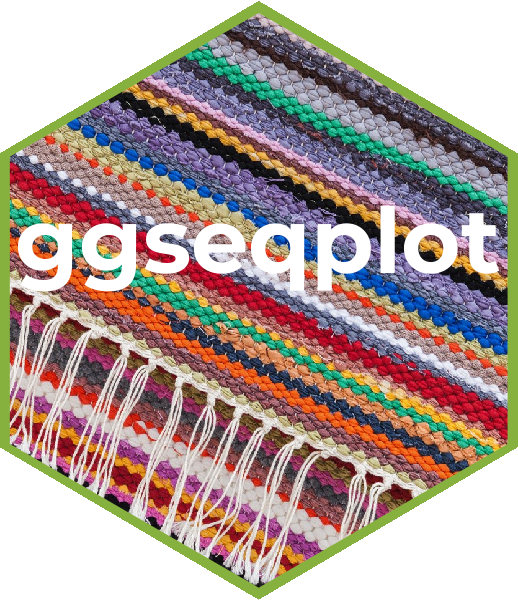

<!-- README.md is generated from README.Rmd. Please edit that file -->

# ggseqplot: ggplotify sequence data plots 

<!-- badges: start -->

[](https://cran.r-project.org/package=ggseqplot)
[](https://github.com/maraab23/ggseqplot/actions/workflows/check-standard.yaml)
[](https://app.codecov.io/gh/maraab23/ggseqplot)
[](https://cranlogs.r-pkg.org/badges/grand-total/ggseqplot)
[](https://maraab23.github.io/ggseqplot/)
[](https://cran.r-project.org/web/licenses/GPL-3)
<!-- badges: end -->

The main goal of [`{ggseqplot}`](https://maraab23.github.io/ggseqplot/)
is to provide functions that reproduce the sequence plots from
<a href="https://traminer.unige.ch"
target="_blank"><code>{TraMineR}</code></a>’s `seqplot` using
<a href="https://ggplot2.tidyverse.org/"
target="_blank"><code>{ggplot2}</code></a>. These plots are produced on
the basis of state sequence objects defined with `TraMineR::seqdef`
(and, for some functions, on the basis of event sequence objects or
regression trees of sequences). The package automates the reshaping and
plotting of sequence data. This library builds on the excellent work of
the <a href="https://traminer.unige.ch"
target="_blank"><code>{TraMineR}</code></a> and
<a href="https://ggplot2.tidyverse.org/"
target="_blank"><code>{ggplot2}</code></a> developers and uses several
of their functions to produce ggplot2-flavored figures.

Note that this library was not written because I personally dislike the
plots produced by <a href="https://traminer.unige.ch"
target="_blank"><code>{TraMineR}</code></a>, but rather because I
normally use <a href="https://ggplot2.tidyverse.org/"
target="_blank"><code>{ggplot2}</code></a> instead of base R’s `plot`
environment for data visualization. <a href="https://traminer.unige.ch"
target="_blank"><code>{TraMineR}</code></a> was developed before
<a href="https://ggplot2.tidyverse.org/"
target="_blank"><code>{ggplot2}</code></a> became as popular as it is
today, when most users were more familiar with base R plots. Today,
however, many researchers and students prefer to use
<a href="https://ggplot2.tidyverse.org/"
target="_blank"><code>{ggplot2}</code></a> and draw on their existing
skills rather than learn base R graphics just to visualize sequence
data.

[`{ggseqplot}`](https://maraab23.github.io/ggseqplot/) contains the
following functions:

- `ggseqdplot` (equivalent to `TraMineR::seqdplot`)
- `ggseqeplot` (equivalent to `TraMineRextras::seqplot.tentrop`)
- `ggseqmsplot` (equivalent to `TraMineR::seqmsplot`)
- `ggseqmtplot` (equivalent to `TraMineR::seqmtplot`)
- `ggseqtrplot` (based on transition rates from `TraMineR::seqtrate`)
- `ggseqimplicplot` (equivalent to the plot method of
  `TraMineRextras::seqimplic`)
- `ggseqiplot` (equivalent to `TraMineR::seqIplot`)
- `ggseqfplot` (equivalent to `TraMineR::seqfplot`)
- `ggseqrplot` (equivalent to `TraMineR::seqrplot`)
- `ggseqrfplot` (equivalent to `TraMineRextras::seqplot.rf`)
- `ggseqpcplot` (equivalent to `TraMineR::seqpcplot`)
- `ggseqtreeplot` (equivalent to `TraMineR::seqtreedisplay`, but without
  requiring an installation of GraphViz)

A complementary
[vignette](https://maraab23.github.io/ggseqplot/articles/ggseqplot.html)
outlines how [`{ggseqplot}`](https://maraab23.github.io/ggseqplot/)
reshapes sequence data generated with
<a href="https://traminer.unige.ch"
target="_blank"><code>{TraMineR}</code></a> functions for visualization
with <a href="https://ggplot2.tidyverse.org/"
target="_blank"><code>{ggplot2}</code></a>. It also shows how to
customize the plots using familiar
<a href="https://ggplot2.tidyverse.org/"
target="_blank"><code>{ggplot2}</code></a> functions and extensions.

If you find errors or have feature requests, feel free to [create an
issue](https://github.com/maraab23/ggseqplot/issues/new) on GitHub or
send me an
[email](mailto:marcel.raab@ifb.uni-bamberg.de?subject=ggseqplot%3A%20feature%20request).

## Citation

If you use [`{ggseqplot}`](https://cran.r-project.org/package=ggseqplot)
in your work, please cite it as:

> Raab, M. (2022). *ggseqplot: Render Sequence Plots using ‘ggplot2’*.
> <https://doi.org/10.32614/CRAN.package.ggseqplot>

You can also retrieve the citation in R with:

``` r
citation("ggseqplot")
```

## Installation

You can install the CRAN version of
[`{ggseqplot}`](https://maraab23.github.io/ggseqplot/) with:

``` r
install.packages("ggseqplot")
```

If a more recent version is available, you can install the development
version from GitHub with:

``` r
devtools::install_github("maraab23/ggseqplot")
```

## Acknowledgements

I would like to thank Gilbert Ritschard, Tim Liao, and Emanuela
Struffolino for their helpful comments on earlier versions of this
library.

## Use of generative AI

The functions `ggseqimplicplot`, `ggseqpcplot`, and `ggseqtreeplot`
(added in version 1.0.0) were written with the assistance of the AI
coding tool
<a href="https://claude.com/claude-code" target="_blank">Claude Code</a>
(Anthropic). The generated code, documentation, and tests were reviewed,
revised, and tested by the package maintainer.
